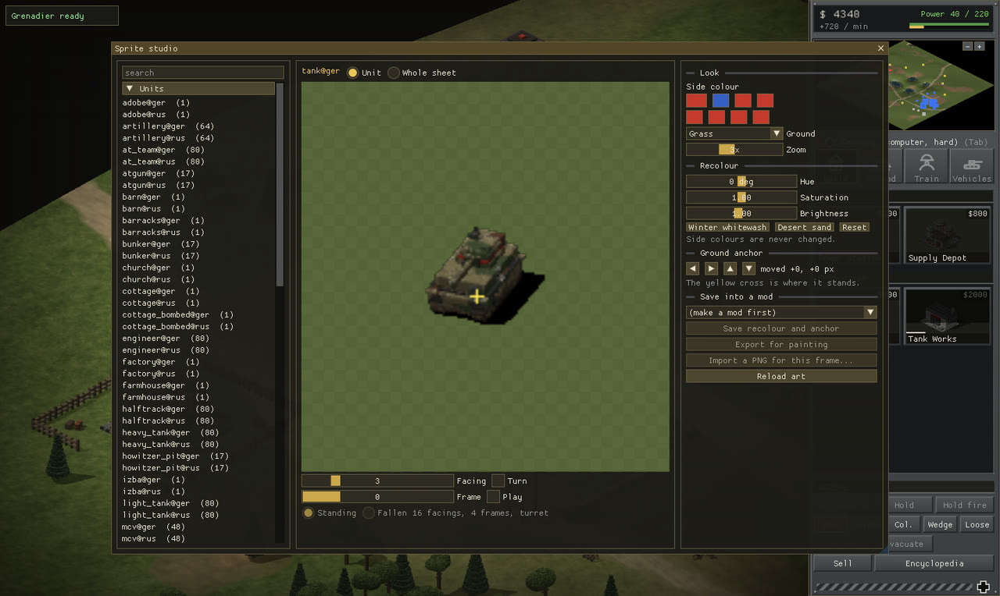

# Legion Classic

**A 2.5D isometric real-time strategy game set in a war that never ended: Europe, 1946.**

Legion Classic plays like the RTS games of the late 1990s and looks like
Blitzkrieg: build a base, run supply trucks, train fireteams and tank platoons,
and dig in behind trenches, wire and tank traps. It runs on its own engine,
**Slave Engine**, and has a scenario editor you can open in the middle of a
battle and change anything, the rules included.


> **Status: in development (0.9.0).** Milestones 1–8 of 10 are done: a full
> skirmish game against the computer, the Live Scenario Editor, and the tools
> for making mods; Milestone 9 has brought a third army, the British. Next: a
> tutorial, campaigns, sound and music. The game is built together with Claude (Anthropic's AI); see
> [How it is made](#how-it-is-made).

## Features

- **Three armies, Germany, the Soviet Union and Britain,** each with a full
  roster: riflemen, MG and anti-tank teams, snipers, engineers, scout cars,
  half-tracks and carriers, light, medium and heavy tanks, tank destroyers,
  howitzers, rocket trucks and self-propelled guns.
- **Real formations.** Men fight as fireteams, squads, platoons and companies;
  tanks and infantry bound together become battle groups. Each unit carries a
  NATO card with its strength.
- **Cover that matters.** Garrison houses and bunkers, put three men in each
  piece of trench, and hit tanks in the side or rear.
- **Fog of war with chips.** Enemies you have spotted but can't see show as
  chips sized by their strength.
- **A computer player with a doctrine per side.** The Germans fortify in depth
  and attack with combined arms; the Soviets mass infantry and artillery and
  stream reinforcements in; the British dig in, bring up the guns and attack
  in set pieces. All of them raid, regroup and expand.
- **Twelve landscapes** in five climates (temperate, winter, desert, tropical,
  urban), with river valleys, lakes, ridges, marshes and towns.
- **Live Scenario Editor (F2).** Sculpt terrain, place units for any side,
  call artillery, and write triggers and objectives while the battle runs.
- **Creation tools and mods.** A rules editor changes any unit, building or
  weapon and the battle follows as you type. A sprite studio recolours,
  repaints and re-anchors any sprite. Save either as a mod and switch it on
  from the main menu.
- **Saves and replays.** The simulation is deterministic, so a replay is just
  the list of orders given.

| | |
| --- | --- |
|  |  |
|  |  |

## Play it

Windows builds are made automatically from every change:

1. Open [**Actions → Build**](../../actions/workflows/build.yml) and click the
   latest green run.
2. Download **LegionClassic-Windows** under *Artifacts* (you need to be signed
   in to GitHub), unzip it and run `LegionClassic.exe`. Nothing to install.

Windows may warn that the game isn't signed: choose **More info → Run anyway**.
How to play, the controls and the editor are in
[docs/PLAYING.md](docs/PLAYING.md).

## Make mods

Mods are folders of rule changes, sprites and scenarios that sit on top of the
game without changing it. Everything about them, and the two creation tools,
is in [docs/MODDING.md](docs/MODDING.md). Replacing art by hand is in
[docs/ART_PIPELINE.md](docs/ART_PIPELINE.md).

## Build it yourself

You need CMake 3.24+ and Visual Studio 2022 (Windows) or GCC 13 / Clang 16
(Linux; plus the X11 / Wayland development packages SDL needs). Libraries are
downloaded automatically at pinned versions.

```bash
cmake -S . -B build -DCMAKE_BUILD_TYPE=Release
cmake --build build --config Release
ctest --test-dir build -C Release      # unit tests
build/bin/LegionClassic                # run the game
```

Headless self-tests drive the real game: `--flow-selftest` (skirmish, save,
load, replay), `--editor-selftest` and `--mods-selftest`.

## How it is built

| Folder | What it holds |
| --- | --- |
| `engine/` | Slave Engine: the deterministic simulation (`sim/`, `core/`, `ecs/`, `map/`) and presentation (`render/`, `assets/`, `platform/`) |
| `game/` | The game itself: battle scene, sidebar, unit cards, menus, encyclopedia |
| `editor/` | The Live Scenario Editor, the rules editor and the sprite studio |
| `content/` | All game data: unit, building and weapon rules, scenarios, art overrides |
| `mods/` | Mods that ship with the game (an example) |
| `tests/` | Unit tests (doctest), including determinism, combat, maps and mods |
| `tools/` | Build-time tools (`make_scenarios.cpp` writes the bundled scenario) |
| `docs/` | Player guide, modding guide, art pipeline and the design document |

- **Deterministic simulation:** integer and fixed-point maths only, seeded
  random numbers, 15 ticks a second. The same orders always give the same
  battle (tested), which makes replays possible and multiplayer later.
- **Everything is data:** units, weapons and armour are defined in
  `content/rules/*.json`, not in code.
- **One way to change the world:** players, the editor and the computer
  players all send commands to the simulation.

The plan, the milestones and the decisions behind them are in
[docs/design/DESIGN.md](docs/design/DESIGN.md); what changed in each build is
in [CHANGELOG.md](CHANGELOG.md).

## How it is made

Legion Classic is designed and play-tested by
[makorain22](https://github.com/makorain22) and written with Claude, Anthropic's
AI model, working in Claude Code. Each milestone is planned together, built,
tested headless in the cloud, then played on Windows; the playtest notes become
the next round of work. Commits made this way are co-authored by Claude.

## Art from Blitzkrieg (optional)

Nival released the data of **Blitzkrieg** (2003) for non-commercial use. The
game can turn it into an art pack for your own use (`--import-blitzkrieg`, see
[docs/ART_PIPELINE.md](docs/ART_PIPELINE.md)). None of that art is in this
repository or in its builds; everything you see in the screenshots is the
game's own voxel art.

## Licence

Copyright © 2026 makorain22. All rights reserved for now: you're welcome to
read the code, build it and play, but please ask before reusing it. An open
licence may follow once the game reaches 1.0. The third-party libraries below
keep their own licences.

## Third-party code

SDL 3 (zlib), Dear ImGui (MIT), nlohmann/json (MIT), stb (public domain / MIT),
miniz (MIT), doctest (MIT), and a glad-generated OpenGL loader (public domain /
CC0).
